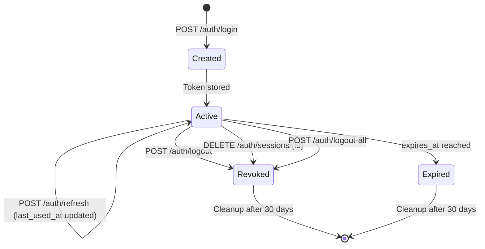
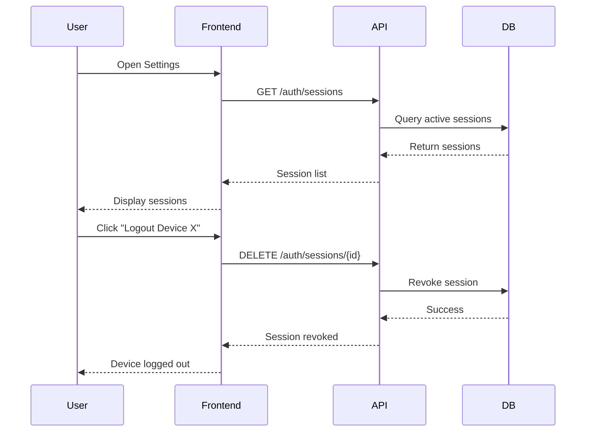

# Enhanced Session Management Implementation Plan

## Executive Summary

This document provides a detailed implementation plan for **Enhanced Session Management** (item 2.3 from the Backend Cookie Auth Implementation Plan). The goal is to transform the current stateless JWT-based authentication into a comprehensive session management system that provides visibility, control, and security monitoring capabilities.

---

## 1. Current State Analysis

### 1.1 What We Have

The current implementation includes:

✅ **Token Revocation Support** (Step 2.2 - Completed):
- [`RefreshToken`](../app/models/refresh_token.py) model with database storage
- SHA-256 hashed refresh tokens stored server-side
- Metadata tracking: `admin_id`, `expires_at`, `revoked_at`, `ip_address`, `user_agent`
- Token rotation on refresh
- Device-specific logout via [`POST /auth/logout`](../app/api/endpoints/auth.py:304)
- Global logout via [`POST /auth/logout-all`](../app/api/endpoints/auth.py:353)
- Automatic revocation on password change

✅ **Cookie-Based Authentication**:
- HttpOnly, Secure, SameSite cookies
- Access tokens (30 min) and refresh tokens (7 days)
- Automatic cookie management via [`set_auth_cookies()`](../app/core/auth_cookies.py:51) and [`clear_auth_cookies()`](../app/core/auth_cookies.py:72)

### 1.2 What's Missing

The current system lacks:

❌ **Session Visibility**:
- No way to view all active sessions for an admin
- Cannot see which devices/locations are logged in
- No session activity tracking beyond `last_used_at`

❌ **Session Management UI/API**:
- No endpoint to list active sessions
- Cannot revoke specific sessions by ID
- No session metadata enrichment (device type, browser, location)

❌ **Session Lifecycle Management**:
- No automatic cleanup of expired sessions
- No session activity monitoring
- No session limits or concurrent session controls

❌ **Security Monitoring**:
- Limited forensic capabilities
- No anomaly detection (unusual IP, device, etc.)
- No session-based security alerts

---

## 2. Target Architecture

### 2.1 Design Philosophy

**Leverage Existing Infrastructure**: The [`RefreshToken`](../app/models/refresh_token.py) table already provides the foundation for session tracking. Rather than creating a separate `admin_sessions` table, we'll enhance the existing model and add session-oriented APIs on top of it.

**Key Insight**: Each refresh token represents a unique session/device. By treating refresh tokens as sessions, we get:
- Natural session lifecycle (created on login, rotated on refresh, revoked on logout)
- Built-in expiration and revocation
- Existing metadata (IP, user agent, timestamps)

### 2.2 Conceptual Model

```
Session = RefreshToken + Enhanced Metadata + Session-Oriented APIs
```

A "session" is:
- **Created** when an admin logs in (refresh token stored)
- **Active** while the refresh token is not revoked and not expired
- **Updated** when the admin refreshes their access token (`last_used_at` updated)
- **Terminated** when explicitly logged out or when the token expires/is revoked

### 2.3 Enhanced Session Attributes

We'll extend the [`RefreshToken`](../app/models/refresh_token.py) model with:

| Field | Type | Purpose |
|-------|------|---------|
| `session_name` | String(100) | User-friendly session identifier (e.g., "Chrome on MacBook Pro") |
| `device_type` | String(50) | Device category: "desktop", "mobile", "tablet", "unknown" |
| `browser_name` | String(50) | Browser name: "Chrome", "Firefox", "Safari", etc. |
| `os_name` | String(50) | Operating system: "Windows", "macOS", "Linux", "iOS", "Android" |
| `location_city` | String(100) | Approximate city (optional, from IP geolocation) |
| `location_country` | String(2) | ISO country code (optional, from IP geolocation) |
| `is_current` | Boolean (computed) | Whether this is the current session (not stored, computed at runtime) |

**Note**: These fields are derived from `user_agent` and `ip_address` at session creation time.

### 2.4 Session Management APIs

New endpoints to be added to [`app/api/endpoints/auth.py`](../app/api/endpoints/auth.py):

| Endpoint | Method | Purpose | Auth Required |
|----------|--------|---------|---------------|
| `/auth/sessions` | GET | List all active sessions for current admin | Yes |
| `/auth/sessions/{session_id}` | GET | Get details of a specific session | Yes |
| `/auth/sessions/{session_id}` | DELETE | Revoke a specific session (logout that device) | Yes |
| `/auth/sessions/current` | GET | Get current session details | Yes |

**Note**: The existing [`POST /auth/logout-all`](../app/api/endpoints/auth.py:353) already provides global session termination.

---

## 3. Detailed Implementation Plan

### 3.1 Database Schema Changes

#### Migration: `021_enhance_refresh_tokens_for_sessions.py`

**Objective**: Add session-oriented metadata fields to the [`refresh_tokens`](../app/models/refresh_token.py) table.

**Changes**:
```python
def upgrade() -> None:
    # Add new columns for enhanced session tracking
    op.add_column('refresh_tokens', 
        sa.Column('session_name', sa.String(length=100), nullable=True))
    op.add_column('refresh_tokens', 
        sa.Column('device_type', sa.String(length=50), nullable=True))
    op.add_column('refresh_tokens', 
        sa.Column('browser_name', sa.String(length=50), nullable=True))
    op.add_column('refresh_tokens', 
        sa.Column('os_name', sa.String(length=50), nullable=True))
    op.add_column('refresh_tokens', 
        sa.Column('location_city', sa.String(length=100), nullable=True))
    op.add_column('refresh_tokens', 
        sa.Column('location_country', sa.String(length=2), nullable=True))
    
    # Add index for efficient session queries
    op.create_index('idx_refresh_tokens_admin_active', 'refresh_tokens', 
                    ['admin_id', 'revoked_at', 'expires_at'])

def downgrade() -> None:
    op.drop_index('idx_refresh_tokens_admin_active', table_name='refresh_tokens')
    op.drop_column('refresh_tokens', 'location_country')
    op.drop_column('refresh_tokens', 'location_city')
    op.drop_column('refresh_tokens', 'os_name')
    op.drop_column('refresh_tokens', 'browser_name')
    op.drop_column('refresh_tokens', 'device_type')
    op.drop_column('refresh_tokens', 'session_name')
```

**Rationale**:
- All fields are nullable to maintain backward compatibility
- Composite index on `(admin_id, revoked_at, expires_at)` optimizes active session queries
- Fields are optional to allow gradual rollout

### 3.2 Model Updates

#### Update [`app/models/refresh_token.py`](../app/models/refresh_token.py)

Add new fields to the `RefreshToken` model:

```python
class RefreshToken(Base):
    __tablename__ = "refresh_tokens"
    
    # ... existing fields ...
    
    # Enhanced session metadata
    session_name = Column(String(100), nullable=True)
    device_type = Column(String(50), nullable=True)  # desktop, mobile, tablet, unknown
    browser_name = Column(String(50), nullable=True)  # Chrome, Firefox, Safari, etc.
    os_name = Column(String(50), nullable=True)  # Windows, macOS, Linux, iOS, Android
    location_city = Column(String(100), nullable=True)
    location_country = Column(String(2), nullable=True)  # ISO country code
    
    __table_args__ = (
        # ... existing indexes ...
        Index("idx_refresh_tokens_admin_active", "admin_id", "revoked_at", "expires_at"),
        # ... existing table args ...
    )
```

### 3.3 User Agent Parsing Utility

#### Create [`app/utils/user_agent_parser.py`](../app/utils/user_agent_parser.py)

**Purpose**: Parse user agent strings to extract device, browser, and OS information.

**Implementation Options**:

**Option A: Lightweight (Recommended for MVP)**
- Use regex patterns for common user agents
- No external dependencies
- Good enough for 90% of cases
- Fast and simple

**Option B: Full-Featured**
- Use `user-agents` or `ua-parser` library
- More accurate parsing
- Requires additional dependency
- Better for production

**Recommended Approach**: Start with Option A, upgrade to Option B if needed.

**Example Implementation (Option A)**:
```python
import re
from typing import Dict, Optional

def parse_user_agent(user_agent: Optional[str]) -> Dict[str, str]:
    """
    Parse user agent string to extract device, browser, and OS info.
    
    Returns a dict with keys: device_type, browser_name, os_name, session_name
    """
    if not user_agent:
        return {
            "device_type": "unknown",
            "browser_name": "unknown",
            "os_name": "unknown",
            "session_name": "Unknown Device"
        }
    
    ua = user_agent.lower()
    
    # Detect device type
    if "mobile" in ua or "android" in ua or "iphone" in ua:
        device_type = "mobile"
    elif "tablet" in ua or "ipad" in ua:
        device_type = "tablet"
    else:
        device_type = "desktop"
    
    # Detect browser
    if "edg" in ua:
        browser_name = "Edge"
    elif "chrome" in ua:
        browser_name = "Chrome"
    elif "firefox" in ua:
        browser_name = "Firefox"
    elif "safari" in ua and "chrome" not in ua:
        browser_name = "Safari"
    else:
        browser_name = "Unknown"
    
    # Detect OS
    if "windows" in ua:
        os_name = "Windows"
    elif "mac os" in ua or "macos" in ua:
        os_name = "macOS"
    elif "linux" in ua:
        os_name = "Linux"
    elif "android" in ua:
        os_name = "Android"
    elif "iphone" in ua or "ipad" in ua:
        os_name = "iOS"
    else:
        os_name = "Unknown"
    
    # Generate session name
    session_name = f"{browser_name} on {os_name}"
    if device_type != "desktop":
        session_name = f"{browser_name} on {os_name} ({device_type.title()})"
    
    return {
        "device_type": device_type,
        "browser_name": browser_name,
        "os_name": os_name,
        "session_name": session_name
    }
```

### 3.4 IP Geolocation Utility (Optional)

#### Create [`app/utils/ip_geolocation.py`](../app/utils/ip_geolocation.py)

**Purpose**: Resolve IP addresses to approximate geographic locations.

**Implementation Options**:

**Option A: No Geolocation (Recommended for MVP)**
- Skip geolocation entirely
- Set `location_city` and `location_country` to `None`
- Simplest approach, no external dependencies

**Option B: Local Database (GeoLite2)**
- Use MaxMind GeoLite2 database (free)
- Requires `geoip2` library and database file
- Offline, fast, privacy-friendly
- Requires periodic database updates

**Option C: External API**
- Use service like ipapi.co, ip-api.com
- Requires network calls (slower)
- Rate limits and potential costs
- Privacy concerns (sending IPs to third party)

**Recommended Approach**: Start with Option A (no geolocation), add Option B later if needed.

**Example Stub (Option A)**:
```python
from typing import Optional, Dict

def get_location_from_ip(ip_address: Optional[str]) -> Dict[str, Optional[str]]:
    """
    Get approximate location from IP address.
    
    Returns a dict with keys: city, country
    """
    # For MVP, return None for both
    return {
        "city": None,
        "country": None
    }
```

### 3.5 Service Layer Updates

#### Update [`app/services/auth.py`](../app/services/auth.py)

**Changes Required**:

1. **Enhance `store_refresh_token()` function**:
   - Parse user agent to extract device/browser/OS info
   - Optionally resolve IP to location
   - Store enhanced metadata in new fields

2. **Add new session management functions**:
   - `get_active_sessions(db, admin_id)` - List all active sessions
   - `get_session_by_id(db, session_id, admin_id)` - Get specific session
   - `revoke_session_by_id(db, session_id, admin_id)` - Revoke specific session
   - `get_current_session(db, refresh_token)` - Get current session details

**Example Implementation**:

```python
from app.utils.user_agent_parser import parse_user_agent
from app.utils.ip_geolocation import get_location_from_ip

def store_refresh_token(
    db: Session,
    admin_id: int,
    refresh_token: str,
    *,
    expires_at: datetime,
    request: Optional[Request] = None,
) -> RefreshToken:
    """Store refresh token with enhanced session metadata."""
    token_hash = hash_refresh_token(refresh_token)
    ip_address, user_agent = _get_request_meta(request)
    
    # Parse user agent for device/browser/OS info
    ua_info = parse_user_agent(user_agent)
    
    # Get location from IP (optional)
    location_info = get_location_from_ip(ip_address)
    
    row = RefreshToken(
        admin_id=admin_id,
        token_hash=token_hash,
        expires_at=expires_at,
        ip_address=ip_address,
        user_agent=user_agent,
        # Enhanced session metadata
        session_name=ua_info["session_name"],
        device_type=ua_info["device_type"],
        browser_name=ua_info["browser_name"],
        os_name=ua_info["os_name"],
        location_city=location_info["city"],
        location_country=location_info["country"],
    )
    db.add(row)
    return row


def get_active_sessions(db: Session, admin_id: int) -> list[RefreshToken]:
    """Get all active (non-revoked, non-expired) sessions for an admin."""
    now = datetime.utcnow()
    return (
        db.query(RefreshToken)
        .filter(RefreshToken.admin_id == admin_id)
        .filter(RefreshToken.revoked_at.is_(None))
        .filter(RefreshToken.expires_at > now)
        .order_by(RefreshToken.last_used_at.desc())
        .all()
    )


def get_session_by_id(
    db: Session, 
    session_id: int, 
    admin_id: int
) -> Optional[RefreshToken]:
    """Get a specific session by ID, ensuring it belongs to the admin."""
    return (
        db.query(RefreshToken)
        .filter(RefreshToken.id == session_id)
        .filter(RefreshToken.admin_id == admin_id)
        .one_or_none()
    )


def revoke_session_by_id(
    db: Session, 
    session_id: int, 
    admin_id: int
) -> bool:
    """Revoke a specific session by ID. Returns True if revoked, False if not found."""
    session = get_session_by_id(db, session_id, admin_id)
    if not session or session.revoked_at is not None:
        return False
    
    session.revoked_at = datetime.utcnow()
    return True


def get_current_session(
    db: Session, 
    refresh_token: str
) -> Optional[RefreshToken]:
    """Get the current session from the refresh token cookie."""
    token_hash = hash_refresh_token(refresh_token)
    return (
        db.query(RefreshToken)
        .filter(RefreshToken.token_hash == token_hash)
        .one_or_none()
    )
```

### 3.6 Schema Definitions

#### Create [`app/schemas/session.py`](../app/schemas/session.py)

**Purpose**: Define Pydantic schemas for session management API responses.

```python
from datetime import datetime
from typing import Optional
from pydantic import BaseModel, Field


class SessionInfo(BaseModel):
    """Schema for session information in API responses."""
    
    id: int = Field(..., description="Session ID")
    session_name: str = Field(..., description="User-friendly session name")
    device_type: str = Field(..., description="Device type: desktop, mobile, tablet, unknown")
    browser_name: str = Field(..., description="Browser name")
    os_name: str = Field(..., description="Operating system name")
    ip_address: Optional[str] = Field(None, description="IP address")
    location_city: Optional[str] = Field(None, description="Approximate city")
    location_country: Optional[str] = Field(None, description="ISO country code")
    created_at: datetime = Field(..., description="Session creation time")
    last_used_at: Optional[datetime] = Field(None, description="Last activity time")
    expires_at: datetime = Field(..., description="Session expiration time")
    is_current: bool = Field(..., description="Whether this is the current session")
    
    class Config:
        from_attributes = True


class SessionListResponse(BaseModel):
    """Schema for listing all sessions."""
    
    sessions: list[SessionInfo] = Field(..., description="List of active sessions")
    total: int = Field(..., description="Total number of active sessions")


class SessionRevokeResponse(BaseModel):
    """Schema for session revocation response."""
    
    message: str = Field(..., description="Success message")
    session_id: int = Field(..., description="ID of revoked session")
```

### 3.7 API Endpoints

#### Add to [`app/api/endpoints/auth.py`](../app/api/endpoints/auth.py)

**1. List All Active Sessions**

```python
@router.get(
    "/sessions",
    response_model=SessionListResponse,
    responses={
        200: {
            "description": "List of active sessions",
            "content": {
                "application/json": {
                    "example": {
                        "sessions": [
                            {
                                "id": 123,
                                "session_name": "Chrome on macOS",
                                "device_type": "desktop",
                                "browser_name": "Chrome",
                                "os_name": "macOS",
                                "ip_address": "192.168.1.100",
                                "location_city": None,
                                "location_country": None,
                                "created_at": "2026-02-07T10:00:00Z",
                                "last_used_at": "2026-02-07T11:00:00Z",
                                "expires_at": "2026-02-14T10:00:00Z",
                                "is_current": True
                            }
                        ],
                        "total": 1
                    }
                }
            }
        },
        401: {"description": "Not authenticated"}
    }
)
def list_sessions(
    request: Request,
    current_admin: Admin = Depends(get_current_admin_from_cookie),
    db: Session = Depends(get_db)
):
    """
    List all active sessions for the current admin.
    
    Returns all non-revoked, non-expired sessions with metadata.
    The current session (based on the refresh token cookie) is marked with is_current=True.
    """
    try:
        # Get all active sessions
        sessions = get_active_sessions(db, current_admin.id)
        
        # Get current session token hash to mark current session
        current_refresh_token = request.cookies.get("refresh_token")
        current_token_hash = hash_refresh_token(current_refresh_token) if current_refresh_token else None
        
        # Build response
        session_list = []
        for session in sessions:
            session_info = SessionInfo(
                id=session.id,
                session_name=session.session_name or "Unknown Device",
                device_type=session.device_type or "unknown",
                browser_name=session.browser_name or "unknown",
                os_name=session.os_name or "unknown",
                ip_address=session.ip_address,
                location_city=session.location_city,
                location_country=session.location_country,
                created_at=session.created_at,
                last_used_at=session.last_used_at,
                expires_at=session.expires_at,
                is_current=(session.token_hash == current_token_hash)
            )
            session_list.append(session_info)
        
        return SessionListResponse(
            sessions=session_list,
            total=len(session_list)
        )
    except Exception as e:
        raise HTTPException(
            status_code=status.HTTP_500_INTERNAL_SERVER_ERROR,
            detail=f"Error listing sessions: {str(e)}"
        )
```

**2. Get Current Session Details**

```python
@router.get(
    "/sessions/current",
    response_model=SessionInfo,
    responses={
        200: {"description": "Current session details"},
        401: {"description": "Not authenticated"},
        404: {"description": "Current session not found"}
    }
)
def get_current_session_details(
    request: Request,
    current_admin: Admin = Depends(get_current_admin_from_cookie),
    db: Session = Depends(get_db)
):
    """
    Get details of the current session.
    
    Returns metadata about the session associated with the current refresh token.
    """
    try:
        # Get current refresh token from cookie
        current_refresh_token = request.cookies.get("refresh_token")
        if not current_refresh_token:
            raise HTTPException(
                status_code=status.HTTP_401_UNAUTHORIZED,
                detail="No active session"
            )
        
        # Get session from database
        session = get_current_session(db, current_refresh_token)
        if not session:
            raise HTTPException(
                status_code=status.HTTP_404_NOT_FOUND,
                detail="Current session not found"
            )
        
        # Verify session belongs to current admin
        if session.admin_id != current_admin.id:
            raise HTTPException(
                status_code=status.HTTP_403_FORBIDDEN,
                detail="Session does not belong to current admin"
            )
        
        return SessionInfo(
            id=session.id,
            session_name=session.session_name or "Unknown Device",
            device_type=session.device_type or "unknown",
            browser_name=session.browser_name or "unknown",
            os_name=session.os_name or "unknown",
            ip_address=session.ip_address,
            location_city=session.location_city,
            location_country=session.location_country,
            created_at=session.created_at,
            last_used_at=session.last_used_at,
            expires_at=session.expires_at,
            is_current=True
        )
    except HTTPException:
        raise
    except Exception as e:
        raise HTTPException(
            status_code=status.HTTP_500_INTERNAL_SERVER_ERROR,
            detail=f"Error getting current session: {str(e)}"
        )
```

**3. Get Specific Session by ID**

```python
@router.get(
    "/sessions/{session_id}",
    response_model=SessionInfo,
    responses={
        200: {"description": "Session details"},
        401: {"description": "Not authenticated"},
        404: {"description": "Session not found"}
    }
)
def get_session_details(
    session_id: int,
    request: Request,
    current_admin: Admin = Depends(get_current_admin_from_cookie),
    db: Session = Depends(get_db)
):
    """
    Get details of a specific session by ID.
    
    Only returns sessions belonging to the current admin.
    """
    try:
        # Get session from database
        session = get_session_by_id(db, session_id, current_admin.id)
        if not session:
            raise HTTPException(
                status_code=status.HTTP_404_NOT_FOUND,
                detail="Session not found"
            )
        
        # Check if this is the current session
        current_refresh_token = request.cookies.get("refresh_token")
        current_token_hash = hash_refresh_token(current_refresh_token) if current_refresh_token else None
        is_current = (session.token_hash == current_token_hash)
        
        return SessionInfo(
            id=session.id,
            session_name=session.session_name or "Unknown Device",
            device_type=session.device_type or "unknown",
            browser_name=session.browser_name or "unknown",
            os_name=session.os_name or "unknown",
            ip_address=session.ip_address,
            location_city=session.location_city,
            location_country=session.location_country,
            created_at=session.created_at,
            last_used_at=session.last_used_at,
            expires_at=session.expires_at,
            is_current=is_current
        )
    except HTTPException:
        raise
    except Exception as e:
        raise HTTPException(
            status_code=status.HTTP_500_INTERNAL_SERVER_ERROR,
            detail=f"Error getting session: {str(e)}"
        )
```

**4. Revoke Specific Session**

```python
@router.delete(
    "/sessions/{session_id}",
    response_model=SessionRevokeResponse,
    responses={
        200: {"description": "Session revoked successfully"},
        401: {"description": "Not authenticated"},
        404: {"description": "Session not found"},
        400: {"description": "Cannot revoke current session (use /auth/logout instead)"}
    }
)
def revoke_session(
    session_id: int,
    request: Request,
    current_admin: Admin = Depends(get_current_admin_from_cookie),
    db: Session = Depends(get_db)
):
    """
    Revoke a specific session by ID (logout that device).
    
    This endpoint allows an admin to remotely logout from another device.
    To logout from the current device, use POST /auth/logout instead.
    """
    try:
        # Get session from database
        session = get_session_by_id(db, session_id, current_admin.id)
        if not session:
            raise HTTPException(
                status_code=status.HTTP_404_NOT_FOUND,
                detail="Session not found"
            )
        
        # Check if trying to revoke current session
        current_refresh_token = request.cookies.get("refresh_token")
        if current_refresh_token:
            current_token_hash = hash_refresh_token(current_refresh_token)
            if session.token_hash == current_token_hash:
                raise HTTPException(
                    status_code=status.HTTP_400_BAD_REQUEST,
                    detail="Cannot revoke current session. Use POST /auth/logout instead."
                )
        
        # Revoke the session
        success = revoke_session_by_id(db, session_id, current_admin.id)
        if not success:
            raise HTTPException(
                status_code=status.HTTP_404_NOT_FOUND,
                detail="Session not found or already revoked"
            )
        
        db.commit()
        
        return SessionRevokeResponse(
            message="Session revoked successfully",
            session_id=session_id
        )
    except HTTPException:
        raise
    except Exception as e:
        db.rollback()
        raise HTTPException(
            status_code=status.HTTP_500_INTERNAL_SERVER_ERROR,
            detail=f"Error revoking session: {str(e)}"
        )
```

### 3.8 Background Task: Expired Session Cleanup

#### Add to [`app/services/auth.py`](../app/services/auth.py)

**Purpose**: Periodically clean up expired sessions from the database.

```python
def cleanup_expired_sessions(db: Session, days_to_keep: int = 30) -> int:
    """
    Delete expired sessions older than the specified number of days.
    
    Args:
        db: Database session
        days_to_keep: Number of days to keep expired sessions (default: 30)
    
    Returns:
        Number of sessions deleted
    """
    cutoff_date = datetime.utcnow() - timedelta(days=days_to_keep)
    
    deleted = (
        db.query(RefreshToken)
        .filter(RefreshToken.expires_at < cutoff_date)
        .delete(synchronize_session=False)
    )
    
    return int(deleted or 0)
```

**Implementation Approach**: Run cleanup on application startup

**Startup Integration**:

Add cleanup call to application startup event in [`app/main.py`](../app/main.py):

```python
@app.on_event("startup")
async def startup_event():
    """Run startup tasks."""
    # Existing startup tasks...
    
    # Clean up expired sessions
    try:
        from app.core.database import SessionLocal
        from app.services.auth import cleanup_expired_sessions
        
        db = SessionLocal()
        try:
            deleted_count = cleanup_expired_sessions(db, days_to_keep=30)
            db.commit()
            logger.info(f"Startup: Cleaned up {deleted_count} expired sessions")
        finally:
            db.close()
    except Exception as e:
        logger.error(f"Startup: Failed to clean up expired sessions: {e}")
```

**Benefits**:
- Simple implementation, no additional dependencies
- Runs automatically on container restart
- Minimal performance impact (runs once at startup)
- Keeps database clean without manual intervention

**Future Enhancement**: Add scheduled task (e.g., daily) if needed for long-running containers.

---

## 4. Implementation Roadmap

### Phase 1: Foundation (MVP)

**Goal**: Basic session visibility and management

**Tasks**:
1. ✅ Create database migration `021_enhance_refresh_tokens_for_sessions.py`
2. ✅ Update [`RefreshToken`](../app/models/refresh_token.py) model with new fields
3. ✅ Create [`app/utils/user_agent_parser.py`](../app/utils/user_agent_parser.py) (lightweight version)
4. ✅ Create [`app/utils/ip_geolocation.py`](../app/utils/ip_geolocation.py) (stub version)
5. ✅ Update [`store_refresh_token()`](../app/services/auth.py:253) to capture enhanced metadata
6. ✅ Add session management functions to [`app/services/auth.py`](../app/services/auth.py)
7. ✅ Create [`app/schemas/session.py`](../app/schemas/session.py)
8. ✅ Add session management endpoints to [`app/api/endpoints/auth.py`](../app/api/endpoints/auth.py)
9. ✅ Write integration tests for new endpoints
10. ✅ Update API documentation

**Deliverables**:
- Admins can view all active sessions
- Admins can see device/browser/OS info for each session
- Admins can revoke specific sessions (remote logout)
- Current session is clearly marked

**Estimated Complexity**: Medium

### Phase 2: Enhancements (Future)

**Goal**: Advanced session features and monitoring

**Tasks**:
1. ⏳ Implement IP geolocation (GeoLite2 database)
2. ⏳ Add session activity tracking (last API call, endpoint accessed)
3. ⏳ Implement concurrent session limits
4. ⏳ Add session anomaly detection (unusual IP, device, etc.)
5. ⏳ Create admin dashboard for session monitoring
6. ⏳ Add session-based security alerts
7. ⏳ Implement automatic cleanup scheduler

**Deliverables**:
- Geographic location for each session
- Session activity timeline
- Configurable session limits
- Security alerts for suspicious activity

**Estimated Complexity**: High

---

## 5. Testing Strategy

### 5.1 Unit Tests

**File**: `tests/unit/test_user_agent_parser.py`

Test cases:
- Parse common user agents (Chrome, Firefox, Safari, Edge)
- Parse mobile user agents (iOS, Android)
- Parse tablet user agents (iPad)
- Handle missing/invalid user agents
- Verify session name generation

**File**: `tests/unit/test_session_service.py`

Test cases:
- `get_active_sessions()` returns only active sessions
- `get_session_by_id()` enforces admin ownership
- `revoke_session_by_id()` marks session as revoked
- `get_current_session()` finds session by token hash
- `cleanup_expired_sessions()` deletes old sessions

### 5.2 Integration Tests

**File**: `tests/integration/test_session_endpoints.py`

Test scenarios:
1. **List Sessions**:
   - Login from multiple devices
   - Verify all sessions appear in list
   - Verify current session is marked correctly
   - Verify session metadata is accurate

2. **Get Current Session**:
   - Login and get current session
   - Verify session details match request metadata
   - Verify `is_current=True`

3. **Get Session by ID**:
   - Get specific session by ID
   - Verify 404 for non-existent session
   - Verify 404 for other admin's session

4. **Revoke Session**:
   - Login from two devices
   - Revoke one session from the other
   - Verify revoked session cannot refresh
   - Verify active session still works
   - Verify cannot revoke current session

5. **Session Lifecycle**:
   - Login → session created
   - Refresh → `last_used_at` updated
   - Logout → session revoked
   - Logout-all → all sessions revoked

6. **Expired Session Cleanup**:
   - Create expired sessions
   - Run cleanup
   - Verify expired sessions deleted
   - Verify active sessions preserved

### 5.3 Security Tests

Test scenarios:
1. **Authorization**:
   - Verify unauthenticated requests return 401
   - Verify admins cannot access other admins' sessions

2. **Session Isolation**:
   - Create sessions for multiple admins
   - Verify each admin sees only their own sessions

3. **Token Validation**:
   - Verify revoked sessions cannot be used
   - Verify expired sessions are not listed

### 5.4 Performance Tests

Test scenarios:
1. **Query Performance**:
   - Create 100+ sessions for one admin
   - Measure query time for `get_active_sessions()`
   - Verify index usage

2. **Cleanup Performance**:
   - Create 10,000+ expired sessions
   - Measure cleanup time
   - Verify no impact on active sessions

---

## 6. API Documentation Updates

### 6.1 OpenAPI Schema Updates

Add new endpoints to OpenAPI spec:
- `GET /auth/sessions` - List all active sessions
- `GET /auth/sessions/current` - Get current session
- `GET /auth/sessions/{session_id}` - Get specific session
- `DELETE /auth/sessions/{session_id}` - Revoke specific session

### 6.2 Response Examples

Include comprehensive examples for:
- Session list with multiple devices
- Current session details
- Session revocation success/error responses

### 6.3 Frontend Integration Guide

Document how frontend should:
- Display session list in user settings
- Show current device indicator
- Implement "Logout Other Devices" button
- Handle session revocation responses

---

## 7. Migration and Rollout Plan

### 7.1 Database Migration

**Step 1**: Run migration in development
```bash
alembic upgrade head
```

**Step 2**: Verify migration success
```bash
# Check new columns exist
mysql -e "DESCRIBE refresh_tokens;"
```

**Step 3**: Run migration in production (with backup)
```bash
# Backup database first
./mysql_backup_script.sh

# Run migration
alembic upgrade head
```

### 7.2 Backward Compatibility

**Existing Sessions**:
- Old refresh tokens (without enhanced metadata) will have `NULL` values for new fields
- API will handle `NULL` gracefully (default to "Unknown Device")
- No data loss or breaking changes

**Gradual Rollout**:
- New sessions will have enhanced metadata
- Old sessions will gradually expire (7 days)
- After 7 days, all sessions will have metadata

### 7.3 Rollback Plan

If issues arise:

**Step 1**: Revert code deployment
```bash
git revert <commit-hash>
```

**Step 2**: Optionally revert database migration
```bash
alembic downgrade -1
```

**Note**: Reverting migration will delete new columns but won't affect existing functionality.

---

## 8. Security Considerations

### 8.1 Privacy

**IP Address Storage**:
- IP addresses are stored for security monitoring purposes
- GDPR allows storing sensitive data for security purposes
- Users will be informed via frontend privacy policy page
- No backend changes required for GDPR compliance

**Geolocation**:
- Not implemented in MVP (Phase 1)
- When implemented (Phase 2), will use local GeoLite2 database
- No third-party data sharing
- Approximate location only (city-level, not precise)

### 8.2 Authorization

**Session Access Control**:
- Admins can only view/revoke their own sessions
- No cross-admin session access
- Enforce admin ownership in all queries

**Current Session Protection**:
- Cannot revoke current session via `DELETE /sessions/{id}`
- Must use `POST /auth/logout` for current session
- Prevents accidental lockout

**Compromised Account Recovery**:

If all admin devices are compromised, recovery options:

1. **Password Change** (Recommended):
   - `POST /auth/change-password` already revokes all refresh tokens
   - Admin must know current password
   - Forces re-login on all devices
   - Attacker loses access immediately

2. **Database-Level Recovery** (Emergency):
   - Direct database access required
   - Manually revoke all sessions for admin:
     ```sql
     UPDATE refresh_tokens
     SET revoked_at = NOW()
     WHERE admin_id = <compromised_admin_id>
     AND revoked_at IS NULL;
     ```
   - Should be documented in security runbook

3. **Future Enhancement - Admin Recovery Endpoint**:
   - Add super-admin capability to revoke sessions for any admin
   - Requires additional admin role/permission system
   - Out of scope for current implementation

**Recommendation**: Document password change as primary recovery method. For complete compromise scenarios, database-level intervention is acceptable as emergency measure.

### 8.3 Rate Limiting

**Session Endpoints**:
- Apply rate limiting to prevent abuse
- Suggested limits:
  - `GET /sessions`: 60 requests/minute
  - `DELETE /sessions/{id}`: 10 requests/minute

---

## 9. Monitoring and Observability

### 9.1 Metrics to Track

**Session Metrics**:
- Total active sessions per admin
- Average session duration
- Session creation rate
- Session revocation rate
- Expired session cleanup count

**Security Metrics**:
- Failed authentication attempts per session
- Unusual IP/device changes
- Concurrent session count per admin

### 9.2 Logging

**Log Events**:
- Session creation (login)
- Session refresh (token rotation)
- Session revocation (logout, logout-all, specific session)
- Session expiration
- Cleanup operations

**Log Format**:
```json
{
  "event": "session_created",
  "admin_id": 1,
  "session_id": 123,
  "device_type": "desktop",
  "browser": "Chrome",
  "os": "macOS",
  "ip_address": "192.168.1.100",
  "timestamp": "2026-02-07T11:00:00Z"
}
```

---

## 10. Future Enhancements

### 10.1 Session Activity Tracking

**Goal**: Track detailed activity per session

**Implementation**:
- Add `last_endpoint` field to track last API call
- Add `request_count` field to track total requests
- Update on every authenticated request

**Use Cases**:
- Identify inactive sessions
- Detect unusual activity patterns
- Provide activity timeline in UI

### 10.2 Concurrent Session Limits

**Goal**: Limit number of active sessions per admin

**Implementation**:
- Add `max_sessions` setting (default: unlimited)
- On login, check active session count
- If limit reached, revoke oldest session

**Use Cases**:
- Prevent session proliferation
- Enforce security policy
- Reduce resource usage

### 10.3 Session Anomaly Detection

**Goal**: Detect suspicious session activity

**Implementation**:
- Track baseline behavior (IP, device, location)
- Alert on deviations (new IP, new device, new location)
- Optional: require re-authentication for anomalies

**Use Cases**:
- Detect account compromise
- Prevent unauthorized access
- Enhance security monitoring

### 10.4 Session Transfer/Migration

**Goal**: Allow users to transfer sessions between devices

**Implementation**:
- Generate one-time transfer code
- Scan QR code on new device
- Transfer session without re-login

**Use Cases**:
- Seamless device switching
- Improved user experience
- Maintain session continuity

---

## 11. Success Criteria

### 11.1 Functional Requirements

✅ **Session Visibility**:
- Admins can view all active sessions
- Session list shows device, browser, OS, IP, timestamps
- Current session is clearly marked

✅ **Session Management**:
- Admins can revoke specific sessions (remote logout)
- Admins can revoke all sessions (logout-all)
- Session revocation is immediate and effective

✅ **Session Lifecycle**:
- Sessions are created on login
- Sessions are updated on refresh
- Sessions are revoked on logout
- Expired sessions are cleaned up

### 11.2 Non-Functional Requirements

✅ **Performance**:
- Session list query < 100ms for 100 sessions
- Session revocation < 50ms
- No impact on existing auth flow performance

✅ **Security**:
- Session data is properly isolated per admin
- No cross-admin session access
- Current session cannot be accidentally revoked

✅ **Usability**:
- API responses are clear and consistent
- Error messages are helpful
- Documentation is comprehensive

### 11.3 Testing Requirements

✅ **Test Coverage**:
- Unit tests for all new functions
- Integration tests for all new endpoints
- Security tests for authorization
- Performance tests for query efficiency

✅ **Test Results**:
- All tests pass
- No regressions in existing functionality
- Performance benchmarks met

---

## 12. Appendix

### 12.1 Database Schema Diagram

```
┌─────────────────────────────────────────────────────────────┐
│ refresh_tokens                                              │
├─────────────────────────────────────────────────────────────┤
│ id (PK)                    INT                              │
│ admin_id (FK)              TINYINT                          │
│ token_hash                 VARCHAR(64) UNIQUE               │
│ created_at                 TIMESTAMP                        │
│ last_used_at               TIMESTAMP                        │
│ expires_at                 DATETIME                         │
│ revoked_at                 TIMESTAMP                        │
│ replaced_by_token_id (FK)  INT                              │
│ ip_address                 VARCHAR(45)                      │
│ user_agent                 VARCHAR(512)                     │
│ ─────────────────────────────────────────────────────────── │
│ session_name               VARCHAR(100)        [NEW]        │
│ device_type                VARCHAR(50)         [NEW]        │
│ browser_name               VARCHAR(50)         [NEW]        │
│ os_name                    VARCHAR(50)         [NEW]        │
│ location_city              VARCHAR(100)        [NEW]        │
│ location_country           VARCHAR(2)          [NEW]        │
└─────────────────────────────────────────────────────────────┘

Indexes:
- idx_refresh_tokens_admin_id (admin_id)
- idx_refresh_tokens_expires_at (expires_at)
- ix_refresh_tokens_token_hash (token_hash) UNIQUE
- idx_refresh_tokens_admin_active (admin_id, revoked_at, expires_at) [NEW]
```

### 12.2 API Endpoint Summary

| Endpoint | Method | Purpose | Auth |
|----------|--------|---------|------|
| `/auth/login` | POST | Create session | No |
| `/auth/refresh` | POST | Refresh session | Cookie |
| `/auth/logout` | POST | Revoke current session | Cookie |
| `/auth/logout-all` | POST | Revoke all sessions | Cookie |
| `/auth/sessions` | GET | List all sessions | Cookie |
| `/auth/sessions/current` | GET | Get current session | Cookie |
| `/auth/sessions/{id}` | GET | Get specific session | Cookie |
| `/auth/sessions/{id}` | DELETE | Revoke specific session | Cookie |

### 12.3 User Agent Parsing Examples

| User Agent | Device | Browser | OS | Session Name |
|------------|--------|---------|----|--------------| 
| `Mozilla/5.0 (Macintosh; Intel Mac OS X 10_15_7) AppleWebKit/537.36 (KHTML, like Gecko) Chrome/120.0.0.0 Safari/537.36` | desktop | Chrome | macOS | Chrome on macOS |
| `Mozilla/5.0 (Windows NT 10.0; Win64; x64; rv:121.0) Gecko/20100101 Firefox/121.0` | desktop | Firefox | Windows | Firefox on Windows |
| `Mozilla/5.0 (iPhone; CPU iPhone OS 17_2 like Mac OS X) AppleWebKit/605.1.15 (KHTML, like Gecko) Version/17.2 Mobile/15E148 Safari/604.1` | mobile | Safari | iOS | Safari on iOS (Mobile) |
| `Mozilla/5.0 (Linux; Android 14) AppleWebKit/537.36 (KHTML, like Gecko) Chrome/120.0.6099.144 Mobile Safari/537.36` | mobile | Chrome | Android | Chrome on Android (Mobile) |

### 12.4 Session Lifecycle Diagram



### 12.5 Session Management Flow



---

## 13. Conclusion

This implementation plan provides a comprehensive roadmap for adding **Enhanced Session Management** to the cookie-based authentication system. By leveraging the existing [`RefreshToken`](../app/models/refresh_token.py) infrastructure and adding session-oriented APIs, we can provide:

✅ **Complete session visibility** - Admins can see all active sessions  
✅ **Granular session control** - Revoke specific sessions or all sessions  
✅ **Rich session metadata** - Device, browser, OS, IP, location, timestamps  
✅ **Security monitoring** - Track session activity and detect anomalies  
✅ **User-friendly experience** - Clear session names and current session indicator  

The plan is designed for **incremental implementation**, starting with an MVP (Phase 1) that delivers core functionality, followed by optional enhancements (Phase 2) for advanced features.

**Next Steps**:
1. Review and approve this plan
2. Create implementation tasks/tickets
3. Begin Phase 1 development
4. Test thoroughly
5. Deploy to production
6. Monitor and iterate

---

**Document Version**: 1.0  
**Last Updated**: 2026-02-07  
**Author**: Architect Mode  
**Status**: Ready for Review
